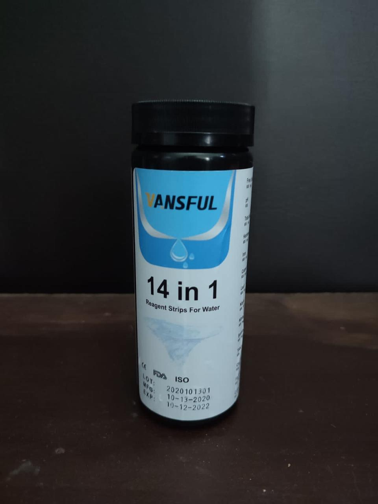
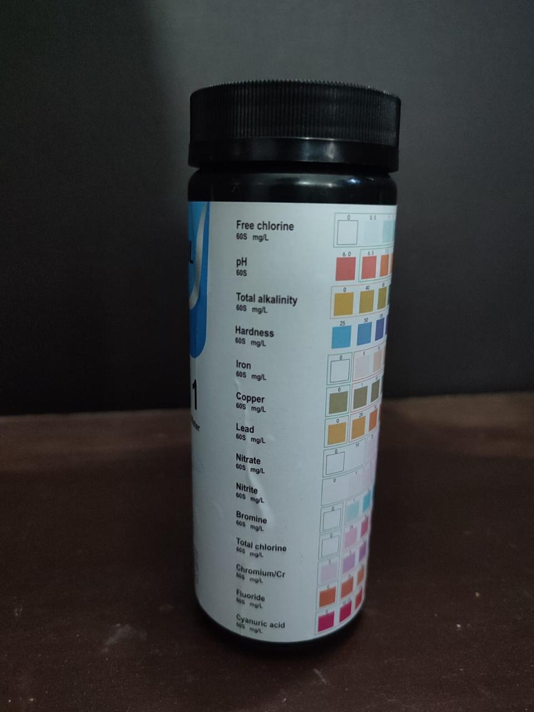
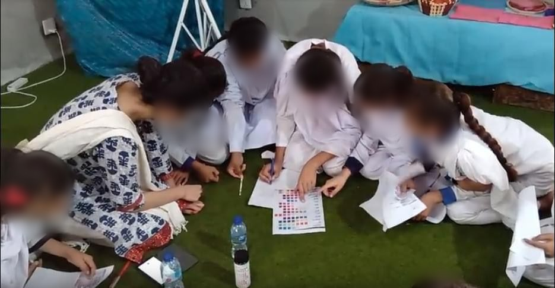
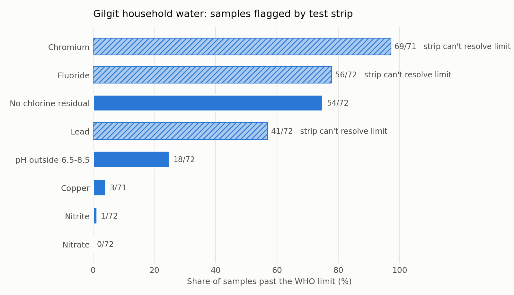

# Project Boondh

**Children testing their own drinking water: a household water-quality study across three schools in Gilgit, Pakistan.**

June–August 2022.

*Boondh* means "drop" in Urdu. The idea is simple: give primary and secondary school students a low-cost water-testing kit, have them test the water they drink at home, and use the results to find where clean water is failing.

**My role:** I designed and led this study: the testing method, the household questionnaire, data collection across the three schools, and the analysis.

 

---

## What happened



- **72 households** across three school sites in Gilgit tested their drinking water on **14 measures** using 14-in-1 reagent strips, and answered a questionnaire about where their water comes from, how they treat it, and whether anyone at home had a water-related illness.
- The strips detected **lead, chromium and fluoride** in most samples, and showed that **three in four samples had no chlorine residual**, meaning the water was not being disinfected by the time it reached the tap.
- Acting on the results, the school had its water tested by the **Pakistan Council of Scientific and Industrial Research (PCSIR)** laboratory, which verified the contamination.
- The school then **installed water filters and stopped students drinking tap water.**

---

## Results from the test strips



| Check | WHO limit | Samples flagged |
|---|---|---|
| No chlorine residual | < 0.2 mg/L | 54 of 72 (75%) |
| pH outside safe range | 6.5–8.5 | 18 of 72 (25%) |
| Copper | > 2 mg/L | 3 of 71 (4%) |
| Nitrite | > 3 mg/L | 1 of 72 |
| Nitrate | > 50 mg/L | 0 of 72 |
| Lead* | > 0.01 mg/L | 41 of 72 (57%) |
| Chromium* | > 0.05 mg/L | 69 of 71 (97%) |
| Fluoride* | > 1.5 mg/L | 56 of 72 (78%) |

20 of the 72 households reported a family member with a water-related illness. Full results by site are in [`results/summary.md`](results/summary.md).

### A low-cost early warning

\*The strips cost a fraction of a laboratory test and can be used by a child at home, which is what makes testing 72 households possible. They are built for detection rather than precise measurement: for lead, chromium and fluoride, the strip's lowest colour step is well above the WHO limit.

| | WHO limit | Lowest step on the strip |
|---|---|---|
| Lead | 0.01 mg/L | 20 mg/L |
| Chromium | 0.05 mg/L | 2 mg/L |
| Fluoride | 1.5 mg/L | 25 mg/L |

That makes a positive reading a strong warning: the contaminant is present at a level far past the safe limit. The strips identified where to look; the school then had the water tested by the PCSIR laboratory, which verified the contamination, and installed filters. Cheap screening followed by targeted lab testing is a model that could reach many more schools than lab testing alone.

The analysis script checks this for every measure, comparing each WHO limit with the strip's lowest step.

---

## Data and privacy

The field spreadsheet recorded children's and parents' names, phone numbers, household income and family illnesses. All participants gave informed consent, and none of those details are published here.

[`analysis/anonymise.py`](analysis/anonymise.py) turns the private sheet into the public dataset:

- every child is replaced by a random sample ID, and rows are shuffled so they can't be matched back to the original sheet
- schools are replaced by neutral site labels (A, B, C)
- names, contact details, income, age and free-text answers are dropped
- illness is kept only as yes / no / unknown for the household
- strip readings are cleaned into numbers; where a colour fell between two pads, both ends of the range are kept

The raw sheet never enters this repository (see `.gitignore`).

---

## Running it

```bash
pip install -r requirements.txt
cd analysis
python analyse.py          # writes results/summary.md and results/exceedances.png
```

## Repository layout

```
project-boondh/
├── data/readings.csv          anonymised strip readings, 72 samples
├── analysis/
│   ├── anonymise.py           private field sheet -> public dataset
│   └── analyse.py             WHO comparison, strip-resolution check, chart
├── results/
│   ├── summary.md             full results table, overall and by site
│   └── exceedances.png        chart above
└── media/                     photos of the test kit
    └── boondh-session.jpg     students testing strips during a session (faces blurred)
```

## What I'd do next

- Use a test with the sensitivity to match drinking-water limits for heavy metals (a low-cost colorimeter or lab panel) so screening and confirmation are one step.
- Re-test the same households after the filters went in, to measure the improvement directly.
- Map results against the local water-pipe network to find where contamination enters the supply.
